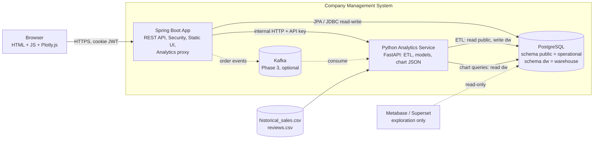
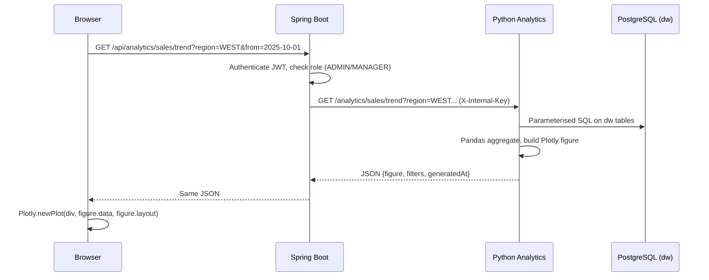
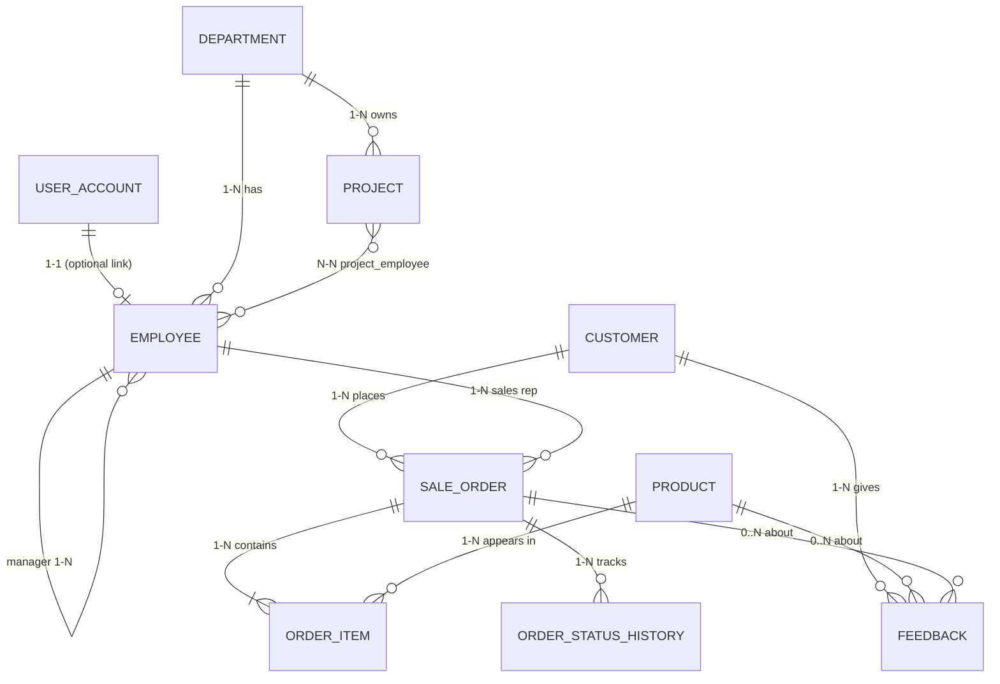
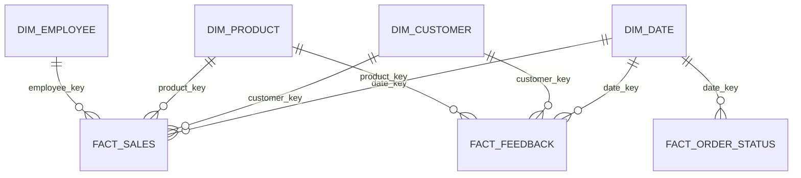

# Company Management System (CMS) — Technical Requirements Document (TRD)

| Field | Value |
|---|---|
| Version | 1.0 (Draft for review) |
| Date | 22 Oct 2026 |
| Implements | `PRD_Company_Management_System.md` |
| Security details | `SECURITY_Company_Management_System.md` |

---

## 1. Introduction

### 1.1 Purpose
This document describes **how** the CMS is built: architecture, technology, data model, APIs, the analytics pipeline, testing and run instructions. Every section traces back to a PRD requirement.

### 1.2 Design principles
1. **Simple first.** Three core components: Spring Boot app, Python analytics service, PostgreSQL. Everything else is optional.
2. **One door for the browser.** The browser only talks to Spring Boot. Spring Boot authenticates every request and forwards analytics calls to Python.
3. **Separate operational and analytical data.** Operational tables (`public` schema) and warehouse tables (`dw` schema) live in the same PostgreSQL server but are separate schemas with separate database users.
4. **Server decides.** Prices, totals, roles and status changes are always computed and checked on the server.
5. **Runs anywhere.** Works from a terminal with JDK 21 and in Antigravity; supporting services start with Docker Compose.

---

## 2. Architecture overview

### 2.1 Component diagram



### 2.2 Data flow for a chart



### 2.3 Trust boundaries
| Zone | Components | Exposure |
|---|---|---|
| Public | Browser ↔ Spring Boot (port 8080) | Only entry point |
| Internal | Python service (port 8000), PostgreSQL (5432), Kafka (9092), BI tool | Not published to the host network except for local development on `127.0.0.1` |

### 2.4 Why this architecture
- A **modular monolith** for the business application keeps debugging, testing and the viva simple (no service discovery, no API gateway).
- A **separate Python service** is used because the analytics libraries are Python-native; it communicates through one small JSON contract.
- **Plotly figures are built in Python and drawn in the browser**, so charts are interactive and still part of the CMS pages.

---

## 3. Technology stack

| Layer | Choice | Reason |
|---|---|---|
| Language / runtime | Java 21 (JDK 21 LTS) | Current LTS; works in terminal and Antigravity |
| Framework | Spring Boot (latest stable from start.spring.io), Spring Web, Spring Data JPA, Spring Security, Spring Validation | Required by the course; standard stack |
| ORM | Hibernate (via JPA) | Required: ORM, entity mapping |
| Database | PostgreSQL 16 | Allowed by evaluation; schemas, window functions, supported by all BI tools. (MySQL works with a driver change.) |
| Auth | JWT (jjwt 0.12.x) + BCrypt | Required: JWT, RBAC |
| API docs | springdoc-openapi (Swagger UI), version matching your Spring Boot line | Required |
| Build | Maven (with wrapper `mvnw`) | Same build in terminal and IDE |
| Frontend | Static HTML + Bootstrap 5 + vanilla JavaScript + Plotly.js (self-hosted files) | No separate Node build; served by Spring Boot |
| Analytics service | Python 3.11+, FastAPI, Uvicorn | Small, fast, auto-docs |
| Analytics libraries | Pandas, NumPy, SQLAlchemy + psycopg, scikit-learn (K-Means), statsmodels (forecast), TextBlob/NLTK (sentiment), Plotly (interactive), Matplotlib + Seaborn (advanced plots) | Required by analytics objectives |
| Real-time (Phase 3) | Apache Kafka (single node, KRaft) + `spring-kafka` + `confluent-kafka` | Objective 10 |
| BI tool (supporting) | Metabase or Apache Superset | Objectives 1, 13, 14 |
| Testing | JUnit 5, Mockito, MockMvc, Spring Security Test, Testcontainers (or H2 for quick tests), Postman, pytest | Required: JUnit, Mockito, REST testing |
| Packaging | Docker Compose for Postgres, Python service, Kafka, BI tool | One command to start support services |

---

## 4. Spring Boot application design

### 4.1 Repository layout
```
company-management-system/
├── backend/                         # Spring Boot (open this folder in IDE / Antigravity)
│   ├── pom.xml
│   ├── mvnw, mvnw.cmd
│   └── src/
│       ├── main/java/com/company/cms/
│       │   ├── CmsApplication.java
│       │   ├── config/              # SecurityConfig, CorsConfig, OpenApiConfig, RestClientConfig
│       │   ├── security/            # JwtService, JwtAuthFilter, UserDetailsServiceImpl, RateLimitFilter
│       │   ├── controller/          # AuthController, EmployeeController, ... AnalyticsController
│       │   ├── service/             # business logic (+ impl classes)
│       │   ├── repository/          # Spring Data JPA interfaces
│       │   ├── entity/              # JPA entities
│       │   ├── dto/                 # request / response DTOs
│       │   ├── mapper/              # entity <-> DTO
│       │   ├── exception/           # custom exceptions + GlobalExceptionHandler
│       │   ├── analytics/           # AnalyticsClient (calls Python service)
│       │   └── event/               # OrderEventPublisher (Phase 3)
│       ├── main/resources/
│       │   ├── application.yml, application-dev.yml, application-prod.yml
│       │   └── static/              # UI: login.html, index.html, pages, js/, css/, vendor/plotly.min.js
│       └── test/java/...
├── analytics/                       # Python service
│   ├── app/ (main.py, api/, etl/, models/, charts/, db.py, config.py)
│   ├── data/ (historical_sales.csv, reviews.csv)
│   ├── tests/
│   └── requirements.txt
├── db/
│   ├── 01_roles.sql                 # DB users and grants
│   ├── 02_dw_schema.sql             # warehouse star schema
│   ├── 03_queries.sql               # sample SQL for sales / customer insights
│   └── seed/                        # seed generator script
├── postman/                         # CMS.postman_collection.json
├── docs/                            # PRD, TRD, SECURITY, BI benchmark report
├── docker-compose.yml
├── .env.example
└── .gitignore
```

### 4.2 Layered architecture
```
Controller  →  Service  →  Repository  →  Database
   (DTOs in/out)   (business rules,       (Spring Data JPA)
                    transactions,
                    ownership checks)
```
| Layer | Responsibility | Must not |
|---|---|---|
| Controller | HTTP mapping, `@Valid` request DTOs, status codes | Contain business logic or touch repositories |
| Service | Business rules, price calculation, status workflow, authorization-by-ownership, `@Transactional` | Return entities to controllers (return DTOs) |
| Repository | Data access via `JpaRepository`, derived queries, `@Query` with parameters | Contain business rules |
| Entity | Table mapping and relationships | Be exposed directly in APIs |
| DTO / Mapper | Shape of request and response | Expose password hashes, internal fields |

### 4.3 Annotations used (viva reference)
`@SpringBootApplication`, `@RestController`, `@RequestMapping`, `@GetMapping/@PostMapping/@PutMapping/@DeleteMapping`, `@PathVariable`, `@RequestParam`, `@RequestBody`, `@Valid`, `@Service`, `@Repository`, `@Entity`, `@Table`, `@Id`, `@GeneratedValue`, `@OneToOne`, `@OneToMany`, `@ManyToOne`, `@ManyToMany`, `@JoinColumn`, `@JoinTable`, `@Transactional`, `@PreAuthorize`, `@RestControllerAdvice`, `@ExceptionHandler`, `@Configuration`, `@Bean`, `@Value` / `@ConfigurationProperties`.

### 4.4 Maven dependencies

| Dependency | Purpose |
|---|---|
| `spring-boot-starter-web` | REST controllers |
| `spring-boot-devtools` (runtime, optional) | Auto-restart in development |
| `spring-boot-starter-validation` | Bean validation |
| `spring-boot-starter-data-jpa` | JPA / Hibernate |
| `postgresql` | JDBC driver (`mysql-connector-j` if MySQL) |
| `spring-boot-starter-security` | Authentication, authorization, headers |
| `jjwt-api`, `jjwt-impl`, `jjwt-jackson` | JWT creation and validation |
| `springdoc-openapi-starter-webmvc-ui` | OpenAPI + Swagger UI |
| `spring-boot-starter-actuator` | Health endpoint only |
| `bucket4j` (or a small custom filter) | Rate limiting |
| `spring-boot-starter-test`, `spring-security-test` | JUnit 5, Mockito, MockMvc |
| `testcontainers` (postgresql) | Repository integration tests (H2 is an acceptable lighter alternative) |
| `spring-kafka` (Phase 3) | Publish order events |
| `lombok` (optional) | Less boilerplate |

> Check the springdoc and jjwt versions against your Spring Boot version when creating the project; mismatches are the most common start-up error.

### 4.5 Code quality rules
- Package by layer as above; class names end with their role (`EmployeeService`, `EmployeeRepository`).
- Constructor injection only; no field `@Autowired`.
- DTOs for all input/output; entities never leave the service layer.
- Methods short and single-purpose; no magic numbers (use constants or config).
- One `GlobalExceptionHandler` for all error mapping.
- No `System.out.println`; use SLF4J logging.
- Javadoc on service methods that implement business rules.

### 4.6 Configuration and profiles
`application.yml` (shared), `application-dev.yml`, `application-prod.yml`. All secrets come from environment variables (see Security doc §3).

```yaml
# application.yml (excerpt)
spring:
  datasource:
    url: ${DB_URL}
    username: ${DB_USER}
    password: ${DB_PASSWORD}
  jpa:
    open-in-view: false
    hibernate:
      ddl-auto: ${JPA_DDL_AUTO:validate}   # dev profile overrides with "update"
app:
  jwt:
    secret: ${JWT_SECRET}               # app fails to start if missing
    expiry-minutes: 30
  analytics:
    base-url: ${ANALYTICS_URL:http://localhost:8000}
    internal-key: ${ANALYTICS_INTERNAL_KEY}
    timeout-seconds: 10
```

---

## 5. Database design (operational schema)

### 5.1 ER diagram



### 5.2 Relationship summary (viva reference)
| Relationship | Type | Mapping |
|---|---|---|
| UserAccount — Employee | One-to-One | `@OneToOne` with `employee_id` unique FK |
| Department — Employee | One-to-Many / Many-to-One | `@OneToMany(mappedBy)` / `@ManyToOne` |
| Employee — Employee (manager) | Many-to-One (self) | `@ManyToOne manager` |
| Project — Employee | Many-to-Many | `@ManyToMany` + `project_employee` join table |
| Customer — SaleOrder | One-to-Many | `@OneToMany` / `@ManyToOne` |
| SaleOrder — OrderItem | One-to-Many (cascade, orphan removal) | `@OneToMany(cascade = ALL, orphanRemoval = true)` |
| OrderItem — Product | Many-to-One | `@ManyToOne` |
| SaleOrder — Employee (sales rep) | Many-to-One | `@ManyToOne` |
| SaleOrder — OrderStatusHistory | One-to-Many | `@OneToMany` |
| Customer — Feedback | One-to-Many | `@OneToMany` / `@ManyToOne` |

### 5.3 Tables and key columns

| Table | Key columns (types) | Constraints |
|---|---|---|
| `user_account` | id, email, password_hash, role (`ADMIN/MANAGER/EMPLOYEE`), enabled, created_at, employee_id | email unique; employee_id unique, nullable |
| `department` | id, name, description, location | name unique |
| `employee` | id, employee_code, first_name, last_name, email, phone, date_of_birth, hire_date, job_title, salary DECIMAL(12,2), status (`ACTIVE/INACTIVE`), department_id, manager_id | code and email unique; salary ≥ 0 |
| `project` | id, name, description, start_date, end_date, status (`PLANNED/ACTIVE/DONE`), department_id | end_date ≥ start_date |
| `project_employee` | project_id, employee_id | composite PK |
| `customer` | id, name, email, phone, region (`NORTH/SOUTH/EAST/WEST/CENTRAL`), created_at | email unique |
| `product` | id, sku, name, category, unit_price, unit_cost, active | sku unique; price, cost > 0 |
| `sale_order` | id, order_no, customer_id, sales_rep_id, order_date, status, discount_percent, total_amount, created_at | discount 0–30; total computed by server |
| `order_item` | id, order_id, product_id, quantity, unit_price, unit_cost, line_total | quantity ≥ 1; price and cost are **snapshots** |
| `order_status_history` | id, order_id, status, changed_at, changed_by | append-only |
| `feedback` | id, customer_id, product_id (nullable), order_id (nullable), rating, comment, created_at | rating 1–5 |

Indexes: `employee(department_id)`, `sale_order(customer_id, order_date, status)`, `order_item(order_id)`, `feedback(created_at)`, `user_account(email)`.

Money values use `DECIMAL(12,2)` / `BigDecimal` (never `double`). Single currency (assumed INR; label configurable).

### 5.4 Order status workflow (enforced in `OrderService`)
```
INQUIRY → QUOTED → CONFIRMED → PAID → DELIVERED
   ↘          ↘         ↘        ↘
                  CANCELLED   (not allowed after DELIVERED)
```
Only the next status or `CANCELLED` is allowed; anything else returns `409 Conflict`.

### 5.5 Database users (least privilege)
| DB user | Rights | Used by |
|---|---|---|
| `cms_app` | Read/write on schema `public` | Spring Boot |
| `cms_etl` | Read on `public`, read/write on `dw` | Python ETL |
| `cms_analytics_ro` | Read on `dw` only | Python chart queries, BI tool |

---

## 6. REST API design

### 6.1 Conventions
- Base path `/api`, JSON only, plural nouns, kebab-case, no verbs in paths (except action endpoints like `/etl/run`).
- Pagination: `?page=0&size=20&sort=lastName,asc`. Responses: `{content, page, size, totalElements}`.
- Dates ISO-8601. Money as decimal strings/numbers with 2 decimals.
- Roles: **A** Admin, **M** Manager, **E** Employee.

### 6.2 Endpoints

| Area | Method and path | Roles | Success | Errors |
|---|---|---|---|---|
| Auth | `POST /api/auth/login` | public | 200 | 400, 401, 429 |
| | `POST /api/auth/logout` | A, M, E | 204 | 401 |
| | `GET /api/auth/me` | A, M, E | 200 | 401 |
| | `POST /api/auth/change-password` | A, M, E | 204 | 400, 401 |
| Users | `GET /api/users`, `GET /api/users/{id}` | A | 200 | 401, 403, 404 |
| | `POST /api/users` | A | 201 | 400, 409 |
| | `PUT /api/users/{id}` | A | 200 | 400, 404 |
| | `DELETE /api/users/{id}` (deactivate) | A | 204 | 404 |
| Departments | `GET /api/departments`, `GET /{id}` | A, M, E | 200 | 404 |
| | `POST` / `PUT /{id}` / `DELETE /{id}` | A | 201 / 200 / 204 | 400, 404, 409 (has employees) |
| Employees | `GET /api/employees` (filters: `q`, `departmentId`, `status`) | A; M (own dept) | 200 | 403 |
| | `GET /api/employees/{id}` | A; M (own dept); E (self) | 200 | 403, 404 |
| | `GET /api/employees/me` | E, M, A | 200 | 401 |
| | `POST` / `PUT /{id}` / `DELETE /{id}` | A | 201 / 200 / 204 | 400, 404, 409 |
| Projects | `GET /api/projects`, `GET /{id}` | A, M; E (assigned) | 200 | 403, 404 |
| | `POST`, `PUT /{id}` | A, M | 201 / 200 | 400, 404 |
| | `DELETE /{id}` | A | 204 | 404 |
| | `POST /api/projects/{id}/employees/{empId}` | A, M | 200 | 404, 409 |
| | `DELETE /api/projects/{id}/employees/{empId}` | A, M | 204 | 404 |
| Customers | `GET /api/customers`, `GET /{id}` | A, M | 200 | 403, 404 |
| | `POST`, `PUT /{id}` | A, M | 201 / 200 | 400, 404, 409 |
| | `DELETE /{id}` | A | 204 | 404, 409 |
| Products | `GET /api/products`, `GET /{id}` | A, M, E | 200 | 404 |
| | `POST`, `PUT /{id}` | A, M | 201 / 200 | 400, 404, 409 |
| | `DELETE /{id}` | A | 204 | 404, 409 |
| Orders | `GET /api/orders` (filters: status, region, dates) | A, M; E (own) | 200 | 403 |
| | `GET /api/orders/{id}` | A, M; E (own) | 200 | 403, 404 |
| | `POST /api/orders` | A, M, E | 201 | 400, 404 |
| | `PATCH /api/orders/{id}/status` | A, M | 200 | 400, 404, 409 |
| | `DELETE /api/orders/{id}` | A | 204 | 404, 409 |
| Feedback | `GET /api/feedback` | A, M | 200 | 403 |
| | `POST /api/feedback` | A, M | 201 | 400 |
| | `PUT /{id}`, `DELETE /{id}` | A | 200 / 204 | 404 |
| Analytics | `GET /api/analytics/**` (see §8.6) | A, M | 200 | 403, 503 |
| | `GET /api/analytics/me` | E, M, A | 200 | 503 |
| | `POST /api/analytics/etl/run` | A | 202 | 409 (already running), 503 |
| | `GET /api/analytics/etl/status` | A | 200 | 503 |

### 6.3 Example: create order
Request `POST /api/orders`
```json
{
  "customerId": 12,
  "discountPercent": 5,
  "items": [ { "productId": 3, "quantity": 2 }, { "productId": 7, "quantity": 1 } ]
}
```
Response `201 Created`
```json
{
  "id": 501, "orderNo": "SO-2026-000501", "status": "INQUIRY",
  "customerId": 12, "salesRepId": 4,
  "items": [ { "productId": 3, "quantity": 2, "unitPrice": 1200.00, "lineTotal": 2400.00 } ],
  "discountPercent": 5, "totalAmount": 3135.00
}
```
Price, cost, total and `salesRepId` are set by the server; any such values sent by the client are ignored.

### 6.4 Validation and error handling
| Rule | Implementation |
|---|---|
| Required / format | `@NotBlank`, `@Email`, `@Size`, `@Pattern` |
| Numbers / ranges | `@Positive`, `@Min(1)`, `@DecimalMax("30")`, `@Min(1) @Max(5)` for rating |
| Dates | `@Past` (date of birth), custom check `endDate ≥ startDate` |
| Business rules | Service layer (status workflow, unique code, delete blocked by dependents) |

All errors go through `@RestControllerAdvice` and use one structure:
```json
{
  "timestamp": "2026-10-22T10:15:30Z",
  "status": 400,
  "error": "Bad Request",
  "message": "Validation failed",
  "path": "/api/employees",
  "correlationId": "c1f4b2e8-...",
  "fieldErrors": [ { "field": "email", "message": "must be a well-formed email address" } ]
}
```
| Exception | HTTP status |
|---|---|
| `MethodArgumentNotValidException`, `ConstraintViolationException` | 400 |
| `AuthenticationException` | 401 |
| `AccessDeniedException` | 403 |
| `ResourceNotFoundException` | 404 |
| `DuplicateResourceException`, `InvalidStatusTransitionException`, `DataIntegrityViolationException` | 409 |
| Rate limit exceeded | 429 |
| Analytics unreachable | 503 (friendly message) |
| Any other exception | 500 with generic message and correlation ID (no stack trace) |

---

## 7. Security design summary
Full detail is in `SECURITY_Company_Management_System.md`. In short:

| Concern | Design |
|---|---|
| Authentication | `POST /api/auth/login` → verify BCrypt hash → issue JWT (HS256, 30 min, contains user id, role, `jti`). |
| Token transport | `httpOnly`, `Secure`, `SameSite=Strict` cookie for the browser UI; `Authorization: Bearer` also accepted for Postman. |
| CSRF | Enabled with a cookie token (`X-XSRF-TOKEN` header); requests carrying a Bearer header are exempt. |
| Logout | Token `jti` stored in a denylist until it expires; cookie cleared. |
| Authorization | `SecurityFilterChain` rules by path, plus `@PreAuthorize` on service methods, plus ownership checks (employee sees only own data). |
| Passwords | BCrypt (strength 12). Never logged or returned. |
| Secrets | Environment variables only; app fails fast when missing. |
| Headers | CSP, `X-Content-Type-Options`, `X-Frame-Options`, HSTS in production. |
| Rate limiting | Login: 5 per minute per IP. |
| Internal calls | Spring → Python with `X-Internal-Key`; Python is not reachable from outside. |

### 7.1 Role–endpoint matrix (enforced twice: filter chain and method security)
| Path pattern | Rule |
|---|---|
| `/api/auth/login`, static assets (`/`, `/login.html`, `/css/**`, `/js/**`) | permit all |
| `/api/users/**` | `hasRole('ADMIN')` |
| `/api/analytics/etl/**` | `hasRole('ADMIN')` |
| `/api/analytics/me` | authenticated |
| `/api/analytics/**` | `hasAnyRole('ADMIN','MANAGER')` |
| `/api/customers/**`, `/api/feedback/**` | `hasAnyRole('ADMIN','MANAGER')` (delete: ADMIN) |
| `/api/orders/**`, `/api/products/**`, `/api/projects/**`, `/api/employees/**`, `/api/departments/**` | authenticated + service-layer rules from §6.2 |
| `/swagger-ui/**`, `/v3/api-docs/**` | enabled in `dev` profile only |
| `/actuator/health` | permit all; every other actuator endpoint disabled |
| everything else | authenticated |

---

## 8. Analytics design

### 8.1 Overview
```
 S1 PostgreSQL (public) ─┐
 S2 historical_sales.csv ─┼─► EXTRACT ─► TRANSFORM (clean, normalize, enrich) ─► LOAD ─► dw (star schema)
 S3 reviews.csv ─────────┘                                                              │
                                                                                         ▼
                                        Python analytics API  ─► Plotly JSON ─► Spring proxy ─► Browser
```

### 8.2 Warehouse schema (`dw`, star schema)



| Table | Columns |
|---|---|
| `dim_date` | date_key (yyyymmdd), full_date, day, month, month_name, quarter, year, is_weekend |
| `dim_customer` | customer_key, source_customer_id, name, region, source_system |
| `dim_product` | product_key, source_product_id, sku, name, category, unit_price, unit_cost |
| `dim_employee` | employee_key, source_employee_id, employee_code, full_name, department_name, job_title |
| `fact_sales` (grain: one order item) | date_key, customer_key, product_key, employee_key, order_id, quantity, revenue, cost, profit, discount_amount, order_status, source_system |
| `fact_feedback` | date_key, customer_key, product_key, rating, review_text_clean, sentiment_score, sentiment_label, source_system |
| `fact_order_status` | order_id, status, status_rank, date_key, changed_at (feeds the funnel) |
| `etl_run_log` | run_id, started_at, finished_at, status, rows_extracted, rows_loaded, rows_rejected, message |

The warehouse intentionally holds **no email, phone, date of birth or salary**.

Sample queries (`db/03_queries.sql`):
```sql
-- Monthly revenue, profit, margin
SELECT d.year, d.month, SUM(f.revenue) AS revenue, SUM(f.profit) AS profit,
       ROUND(100 * SUM(f.profit) / NULLIF(SUM(f.revenue),0), 2) AS profit_margin_pct
FROM dw.fact_sales f JOIN dw.dim_date d ON d.date_key = f.date_key
WHERE f.order_status IN ('PAID','DELIVERED')
GROUP BY d.year, d.month ORDER BY d.year, d.month;

-- Revenue growth rate vs previous month
WITH m AS (
  SELECT d.year, d.month, SUM(f.revenue) AS revenue
  FROM dw.fact_sales f JOIN dw.dim_date d USING (date_key)
  WHERE f.order_status IN ('PAID','DELIVERED') GROUP BY d.year, d.month)
SELECT year, month, revenue,
       ROUND(100 * (revenue - LAG(revenue) OVER (ORDER BY year, month))
             / NULLIF(LAG(revenue) OVER (ORDER BY year, month),0), 2) AS growth_pct
FROM m ORDER BY year, month;

-- Top 10 customers by lifetime value
SELECT c.name, c.region, SUM(f.revenue) AS lifetime_value
FROM dw.fact_sales f JOIN dw.dim_customer c USING (customer_key)
GROUP BY c.name, c.region ORDER BY lifetime_value DESC LIMIT 10;
```

### 8.3 ETL pipeline (Python, `analytics/app/etl/`)

| Step | What happens | Objective |
|---|---|---|
| **Extract** | S1 via SQLAlchemy (read-only on `public`); S2 and S3 via `pandas.read_csv` | 5, 12 |
| **Clean** | Drop exact duplicates; fix data types and date formats; fill or drop missing values (numeric → median, categorical → "Unknown", missing keys → reject); trim and standardise text and region names; remove negative or zero quantities/prices (rejected rows are counted and logged) | 2 |
| **Normalize** | Min-max or z-score scaling for clustering features; lowercase and strip punctuation in review text; currency and unit consistency | 2 |
| **Transform** | Compute revenue, cost, profit; map natural keys to surrogate keys; join employees and departments; compute RFM features; tag `source_system` (`APP`, `CSV_HISTORY`, `CSV_REVIEWS`) | 4, 12 |
| **Enrich** | Sentiment score and label per review | 6 |
| **Load** | Idempotent: upsert dimensions; fact tables replaced per run (truncate-and-load for a small dataset) inside one transaction | 4, 5 |
| **Log** | Row counts and status written to `dw.etl_run_log` | AN-11 |

Triggers: nightly schedule (APScheduler) and on-demand from `POST /etl/run` (Admin button). A second run while one is active returns `409`.
Optional: reproduce the same flow in Pentaho or Talend and keep screenshots as evidence for objective 5.

### 8.4 Analysis methods

| Feature | Method | Key parameters |
|---|---|---|
| KPIs (AN-1) | SQL aggregates on `fact_sales`; growth = (current − previous) ÷ previous; margin = profit ÷ revenue | Date range, region |
| Sales/Profit, Regional (AN-2, AN-3) | Group-by in Pandas; Plotly line, bar, heatmap | Granularity, category |
| Funnel (AN-4) | Count distinct orders that reached each status (`fact_order_status`); conversion = stage ÷ previous stage | Date range, region, rep |
| Forecast (AN-5) | Monthly aggregation → Holt-Winters exponential smoothing (statsmodels); 80/20 time split to compute MAPE; confidence band from residual std | Horizon 3–12; needs ≥ 24 months of history |
| Segments (AN-6) | RFM per customer → `StandardScaler` → `KMeans(k, n_init=10, random_state=42)`; silhouette score shown; segment names from centroid ranking (e.g. Champions, Loyal, At risk, Low value) | k 2–8 (default 4) |
| Sentiment (AN-7) | TextBlob polarity (> 0.1 positive, < −0.1 negative, otherwise neutral); VADER from NLTK as alternative; compare with rating | Date range, product |
| Unified report (AN-8) | Merge `fact_sales` + `dim_employee` + average sentiment per product/period, across S1 and S2 | Date range, department |
| Advanced plots (AN-9) | Matplotlib/Seaborn → PNG bytes (correlation heatmap, box/violin plot, histogram, pair plot) with fixed allow-listed plot names | `plot` name |
| Live feed (AN-10) | Kafka consumer updates in-memory counters; browser polls a snapshot endpoint every 5 s | none |

### 8.5 Chart response contract (Python → Spring → Browser)
```json
{
  "title": "Revenue and Profit by Month",
  "figure": { "data": [ { "type": "scatter", "x": [...], "y": [...], "name": "Revenue" } ],
              "layout": { "xaxis": { "title": "Month" }, "yaxis": { "title": "Amount (INR)" } } },
  "filters": { "region": "WEST", "from": "2025-10-01", "to": "2026-09-30" },
  "summary": { "totalRevenue": 1250000.50 },
  "generatedAt": "2026-10-22T10:20:00Z"
}
```
Static plots return `image/png`. The browser renders with `Plotly.newPlot(div, figure.data, figure.layout, {responsive:true})`.

### 8.6 Analytics endpoints

| Spring endpoint (browser calls) | Python endpoint (internal) | Query parameters |
|---|---|---|
| `GET /api/analytics/kpis` | `/analytics/kpis` | `from`, `to`, `region` |
| `GET /api/analytics/sales/trend` | `/analytics/sales/trend` | `from`, `to`, `region`, `category`, `granularity` |
| `GET /api/analytics/sales/regional` | `/analytics/sales/regional` | `from`, `to`, `category` |
| `GET /api/analytics/funnel` | `/analytics/funnel` | `from`, `to`, `region`, `repId` |
| `GET /api/analytics/forecast` | `/analytics/forecast` | `horizon`, `region` |
| `GET /api/analytics/segments` | `/analytics/segments` | `k` |
| `GET /api/analytics/sentiment` | `/analytics/sentiment` | `from`, `to`, `productId` |
| `GET /api/analytics/unified` | `/analytics/unified` | `from`, `to`, `departmentId` |
| `GET /api/analytics/advanced/{plot}.png` | `/analytics/advanced/{plot}.png` | none |
| `GET /api/analytics/live` | `/analytics/live` | none (Phase 3) |
| `GET /api/analytics/me` | `/analytics/me` | `from`, `to` (employee id taken from the JWT, not the request) |
| `POST /api/analytics/etl/run`, `GET .../etl/status` | `/etl/run`, `/etl/status` | none |

Input handling in Python: parameters are validated with Pydantic (region must be one of the enum values, dates are real dates and range-limited, `k` 2–8, `horizon` 3–12, `plot` from an allow-list). All SQL uses bound parameters.

### 8.7 Spring ↔ Python integration
| Topic | Design |
|---|---|
| Client | `RestClient` (or `WebClient`) in `AnalyticsClient`; base URL and key from config |
| Authentication | `X-Internal-Key` header, compared in constant time by Python |
| User context | Spring sets `X-User-Employee-Id` for the "me" endpoint; the browser cannot set it |
| Timeouts | Connect 2 s, read 10 s |
| Failure | Timeout or connection error → Spring returns `503` with a friendly message; CMS CRUD keeps working |
| Caching | Python caches chart results for 5 minutes per parameter set (invalidated after ETL) |

### 8.8 Real-time with Kafka (Phase 3)
- Topic `sales.order.events`. Spring Boot publishes an event **after the order transaction commits** (`@TransactionalEventListener(phase = AFTER_COMMIT)`).
- Event payload: `orderId`, `status`, `totalAmount`, `region`, `occurredAt` (no personal data).
- Python consumer keeps today's running total, count and last 20 orders; `GET /analytics/live` returns the snapshot; the browser polls every 5 seconds and updates a live chart.
- Kafka runs as a single node in Docker Compose bound to localhost.

### 8.9 Open-source BI tool use and benchmark (objectives 1, 13, 14)
1. Start Metabase (and optionally Superset) from Docker Compose; connect with the `cms_analytics_ro` user.
2. Build basic visualizations (objective 1), KPI cards and a funnel (objectives 8 and 13).
3. **Benchmark plan (objective 14):** generate 1M+ rows into `fact_sales` using the seed script; run five fixed report queries (monthly revenue, revenue by region, top customers, funnel, product category share) in (a) Metabase, (b) Superset, (c) the in-app Python/Plotly dashboard. Record cold and warm response times (median of 5 runs), memory use and ease of building each report. Present as a table in `docs/bi-benchmark.md`.

---

## 9. Frontend design

### 9.1 Pages
| Page | Content | Roles |
|---|---|---|
| `login.html` | Login form | public |
| `index.html` | Home with a few KPI cards and shortcuts | all |
| `employees.html`, `departments.html`, `projects.html` | Tables with search, pagination, create/edit forms | by role |
| `customers.html`, `products.html`, `orders.html`, `feedback.html` | Tables and forms; order form with item rows | by role |
| `users.html` | Admin user management | Admin |
| `analytics.html` | Tabs: Overview, Sales & Profit, Regions, Funnel, Forecast, Segments, Sentiment, Unified, Advanced, Live, Pipeline | Admin, Manager |
| `my-performance.html` | Personal KPI card | Employee |

### 9.2 Behaviour rules
- Navigation items are hidden by role for usability, but **the server enforces access** (hiding is never the security control).
- Filters (date range, region, category) are form controls; changing one triggers a fetch and `Plotly.react` to redraw the chart.
- User-supplied text (names, review text) is inserted with `textContent`, never `innerHTML`.
- Plotly.js, Bootstrap and fonts are **self-hosted** in `static/vendor/` so that the Content-Security-Policy can restrict scripts to the same origin.
- Authentication state comes from `GET /api/auth/me`; the JWT is in an `httpOnly` cookie and is never read by JavaScript. Nothing sensitive is stored in `localStorage`.

---

## 10. DevOps and environments

### 10.1 Docker Compose services
| Service | Image / build | Ports (host) |
|---|---|---|
| `postgres` | `postgres:16` | `127.0.0.1:5432` |
| `analytics` | build from `analytics/` | `127.0.0.1:8000` (dev) or none |
| `kafka` (Phase 3) | Apache Kafka, KRaft mode | `127.0.0.1:9092` |
| `metabase` (optional) | `metabase/metabase` | `127.0.0.1:3000` |
| `backend` (optional) | build from `backend/` | `8080` |

During development you normally run Spring Boot from the IDE and the others through Compose.

### 10.2 Environment variables (`.env.example`, placeholders only)
```
DB_URL=jdbc:postgresql://localhost:5432/cms
DB_USER=cms_app
DB_PASSWORD=change-me
JWT_SECRET=change-me-to-a-random-value-of-at-least-32-bytes
ANALYTICS_URL=http://localhost:8000
ANALYTICS_INTERNAL_KEY=change-me
ETL_DB_USER=cms_etl
ETL_DB_PASSWORD=change-me
ANALYTICS_RO_DB_USER=cms_analytics_ro
ANALYTICS_RO_DB_PASSWORD=change-me
SPRING_PROFILES_ACTIVE=dev
```

### 10.3 CI (optional)
GitHub Actions: build and test the backend (`./mvnw verify`), run `pytest` for analytics, run a secret scan (Gitleaks) and dependency checks.

---

## 11. Testing strategy

| Level | Tool | What is tested |
|---|---|---|
| Unit (service) | JUnit 5 + Mockito | Price calculation, status workflow, ownership rules, duplicate checks |
| Controller | `@WebMvcTest` + MockMvc | Status codes, validation errors, JSON shape |
| Security | MockMvc + `spring-security-test` (`@WithMockUser(roles=...)`) | 401/403 for each role on each endpoint group; IDOR checks |
| Repository | `@DataJpaTest` + Testcontainers (or H2) | Queries, relationships, constraints |
| Integration | `@SpringBootTest` | Login → JWT → protected endpoint; order creation end to end |
| API (manual and automated) | Postman collection + Newman | Full CRUD flows for each role, negative cases, security cases |
| Analytics | pytest | ETL cleaning rules, KPI formulas, K-Means output shape, sentiment labels, parameter validation |
| Performance | Seeded 100k-row and 1M-row data | Dashboard timings; BI benchmark |

Test data: `db/seed/` generates deterministic demo data (fixed random seed) so results are repeatable.

---

## 12. Non-functional design

| Topic | Design |
|---|---|
| Performance | DB indexes (§5.3); pagination everywhere; `open-in-view: false`; fetch joins to avoid N+1; warehouse pre-aggregation; 5-minute chart cache |
| Reliability | ETL is idempotent and transactional; analytics failures isolated behind 503; DB healthcheck in Compose |
| Logging | SLF4J; JSON or plain logs with correlation ID; no passwords, tokens or personal data in logs |
| Monitoring | `/actuator/health` only; ETL status page |
| Backup | `pg_dump` script for demo environment |
| Scalability (explained, not built) | Stateless Spring app can run several instances; analytics reads only from `dw` |

---

## 13. Run instructions (JDK and Antigravity)

### 13.1 Prerequisites
JDK 21, Docker Desktop, Python 3.11+, Git. Verify with `java -version`, `docker --version`, `python --version`.

### 13.2 Start order
1. `cp .env.example .env` and set real values (never commit `.env`).
2. `docker compose up -d postgres` (add `kafka metabase` later).
3. Create DB roles and warehouse schema: run `db/01_roles.sql` and `db/02_dw_schema.sql`.
4. Python service:
   ```
   cd analytics
   python -m venv .venv && source .venv/bin/activate   # Windows: .venv\Scripts\activate
   pip install -r requirements.txt
   uvicorn app.main:app --port 8000
   ```
5. Backend (terminal with JDK): `cd backend && ./mvnw spring-boot:run` (Windows: `mvnw.cmd spring-boot:run`).
6. Seed data, then open `http://localhost:8080`, Swagger at `http://localhost:8080/swagger-ui.html` (dev only).

### 13.3 Opening in Antigravity
1. Open the `backend/` folder (or the repository root).
2. Let the IDE import the Maven project; set the project JDK to **21**.
3. Run the `CmsApplication` main class (or the Maven `spring-boot:run` goal in its terminal), with the environment variables supplied from `.env` or the run configuration.
4. Confirm the same endpoints respond as in the terminal run. Running the project successfully both ways is the proof for the "JDK and Antigravity" requirement.

---

## 14. Viva and demo script (about 10 minutes)

| Min | Show | Evaluation point |
|---|---|---|
| 0–1 | Problem, architecture diagram (§2.1) | 1, 7 |
| 1–2 | Project structure and layers in the IDE | 2, 7, 11 |
| 2–3 | ER diagram and entity code with relationships | 4, 5 |
| 3–5 | Swagger/Postman: CRUD, status codes, validation error, role denial (403) | 3, 6, 8, 9, 10 |
| 5–6 | JWT login, token claims, RBAC in `SecurityConfig` | 9 |
| 6–7 | Run tests (JUnit/Mockito) | 10 |
| 7–9 | Analytics tab: filters, funnel, forecast, segments, sentiment, ETL status | Analytics 3–9, 12, 13 |
| 9–10 | Kafka live feed and BI benchmark results (Phase 3) | Analytics 1, 10, 14 |
| End | Your individual contribution | 12 |

---

## 15. Requirement-to-design traceability (condensed)

| PRD requirement | Design section |
|---|---|
| FR-AUTH-* | §6.2 Auth, §7 |
| FR-DEP/EMP/PRJ/CUS/PRD/ORD/FDB | §5, §6.2, §4.2 |
| FR-PLT-1 | §6.4 |
| FR-PLT-2 | §3 (springdoc), §7.1 |
| FR-PLT-3 | §11 (seed), §4.1 (`db/seed`) |
| AN-1 to AN-9, AN-12 | §8.2–8.6 |
| AN-10 | §8.8 |
| AN-11 | §8.3 (`etl_run_log`), §6.2 |
| NFR performance | §5.3 indexes, §8.7 caching, §12 |
| NFR security/privacy | §7, Security document |
| NFR portability | §10, §13 |

---

## 16. Risks and open technical questions

| Item | Note / decision needed |
|---|---|
| PostgreSQL vs MySQL | Draft assumes PostgreSQL; MySQL requires only driver and dialect changes plus a different BI connection |
| Metabase vs Superset | Metabase is quicker to set up; Superset fits Python skills better |
| Version compatibility | Confirm springdoc and jjwt versions against the chosen Spring Boot version at project creation |
| CSP and Plotly | Plotly may need `style-src 'unsafe-inline'`; allow only what the browser console reports |
| Kafka effort | Keep as Phase 3; the rest of the system must not depend on it |
